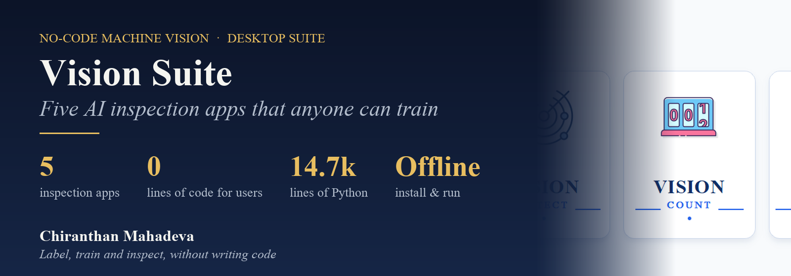
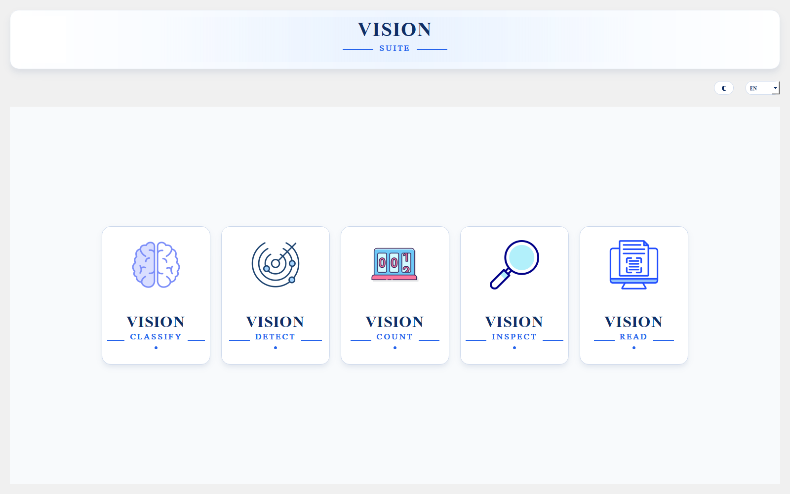
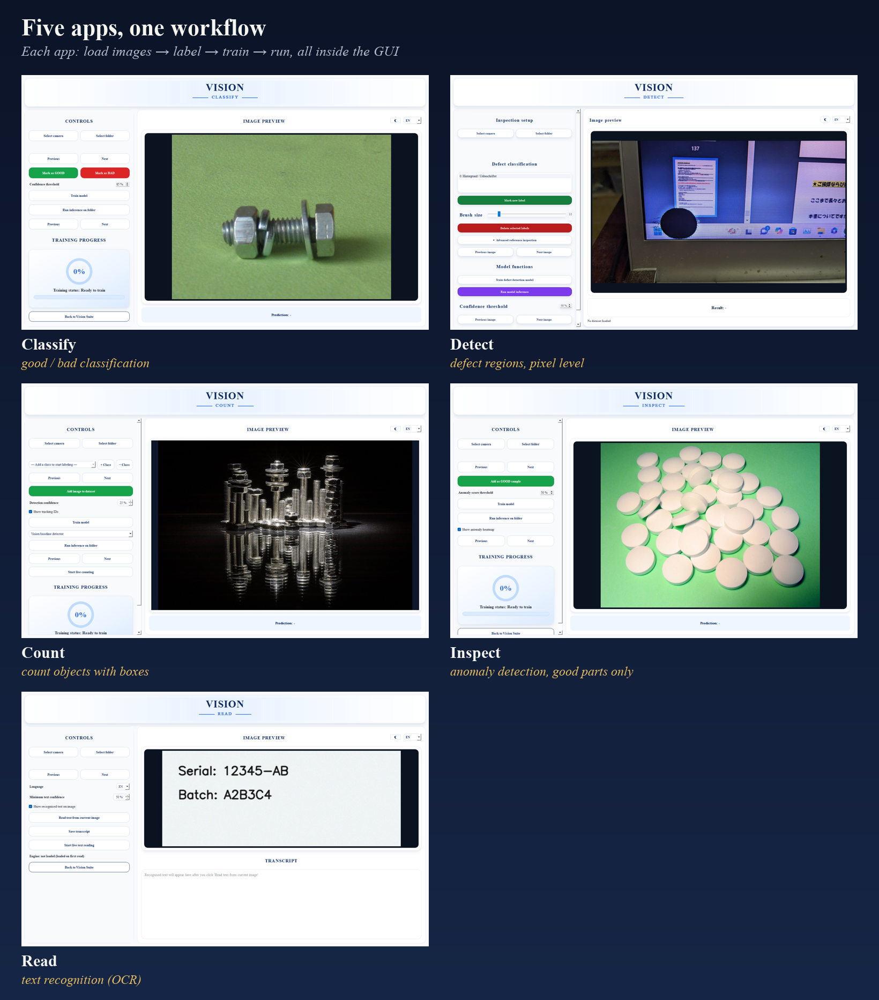
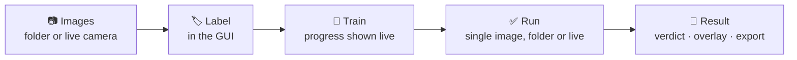
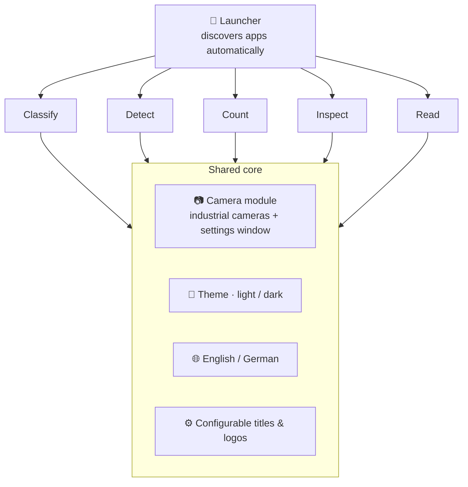

  

  
  
  
  

  <b>A desktop suite I designed and built on my own: five machine-vision apps behind one launcher, 
  so an operator can label images, train an AI model and inspect parts without writing a single line of code.</b>

> **Source code is private.** It was built in an industrial setting. This page shows what I built and how. Screenshots are from the real software, with sample photos from Wikimedia Commons ([credits](#-image-credits)).

---

## 🎯 The idea

Industrial AI inspection usually needs a data scientist: someone who writes training scripts, tunes models and deploys them.
**Vision Suite puts that whole loop into a desktop app.** The person who knows the parts labels a few images, clicks *Train*, and runs the inspection, all in the same window.

## 🧰 Five apps, one workflow

| App | Question it answers | How it learns |
|---|---|---|
| **Classify** | Is this part *good* or *bad*? | Mark images as GOOD / BAD → train a classifier with built-in augmentation |
| **Detect** | *Where* exactly is the defect? | Paint defect regions → pixel-level segmentation, plus a **golden-template** comparison that drafts the first mask automatically |
| **Count** | *How many* objects are there? | Draw boxes per class → object detector, with optional tracking IDs for live counting |
| **Inspect** | Does this look *unusual*? | Train on **good parts only**, then flag anomalies with a heat-map, with no defect samples needed |
| **Read** | What *text* is printed here? | Ready-to-use text recognition, with a confidence threshold, live reading and transcript export |

Every app follows the same rhythm, so learning one means knowing all five:

## 🏗️ How I built it

- **Plug-in apps.** The launcher doesn't know the apps in advance. It **discovers** every folder containing a small `app.json` marker. Adding a sixth app means dropping in a folder, with no change to the launcher.
- **Each app runs alone or inside the suite.** Every app has its own start file, so a production PC can run just the one it needs.
- **One shared core** for the camera, theme, language and branding, so all apps look and behave the same.
- **White-label ready.** Titles and logos come from a config file, so the same software can be rebranded per customer.
- **Built for offline factory PCs.** A bundled package wheelhouse installs everything **without internet**, a common requirement on production networks.
- **Two languages and two themes**, switchable at runtime.

## 🔁 How it grew

| Version | What I added |
|---|---|
| **V1** | Classification and segmentation, merged into one application |
| **V2** | Golden-reference format · labelling by mirroring (no manual sketching for symmetric parts) · redesigned GUI |
| **V3** | Industrial camera integration and a camera-setup tool · new **Read**, **Inspect** and **Count** apps · the suite launcher |

## 🧪 Tested like a product

I kept a **development log** of structured test runs: what a first-time user sees, where they hesitate, and what to improve next. Two typical findings:
- **"Is it frozen?"** The training progress ring showed 92 % while training was only halfway through its epochs. Without a visible log, a user would assume the software had hung, so progress has to follow the real training state.
- **"How much have I labelled?"** While labelling, the user gets no feedback on how many images are GOOD vs BAD, so a live dataset-balance indicator belongs in the next version.

## 💡 What I learned

1. **The user is not the developer.** The hardest part isn't the models. It's making training understandable to someone who has never heard of epochs, and a test log is how you find out where that fails.
2. **Consistency scales.** One shared core and one workflow made five apps feel like one product.
3. **Design for the factory, not the lab.** Offline installs, live cameras, standalone apps and two languages are what make software usable on a real line.

## 🧰 Tech stack

**Python** · **PyQt5** desktop GUI · **PyTorch** (training and inference) · **OpenCV** · industrial camera SDK · JSON config · PyInstaller · offline wheelhouse

## 🖼️ Image credits

Sample photos in the screenshots, from Wikimedia Commons:
[Rondelle 07](https://commons.wikimedia.org/wiki/File:Rondelle_07.jpg) (Tiesse, public domain) ·
[LCD Crack of Laptop Computer](https://commons.wikimedia.org/wiki/File:LCD_Crack_of_Laptop_Computer.jpg) (Mr.ちゅらさん, CC0) ·
[Schrauben, Muttern und Unterlegscheiben](https://commons.wikimedia.org/wiki/File:Schrauben,_Muttern_und_Unterlegscheiben_--_2020_--_4150.jpg) (Dietmar Rabich, CC BY-SA 4.0) ·
[Flattened round pills](https://commons.wikimedia.org/wiki/File:FlattenedRoundPills.jpg) (David Richfield, CC BY-SA 3.0).
Images containing CC BY-SA photos are shared under the same licence.

---

  <b>Chiranthan Mahadeva</b> · Industrial machine vision & AI 
  More: <a href="https://github.com/Gojoinferno/VisionChat-Agent">VisionChat-Agent</a> ·
  <a href="https://github.com/Gojoinferno/MachineVision-Research">MachineVision-Research</a> ·
  <a href="https://github.com/Gojoinferno/Realtime-DigitOCR">Realtime-DigitOCR</a>

